<a href="https://thecompiledmind.dev">
  <picture>
    <source media="(prefers-color-scheme: dark)" srcset="assets/banner-dark.svg">
    
  </picture>
</a>

  <b>Senior Staff Engineer @ Falkor</b> (formerly Kongsberg Digital) · Bengaluru

  I lead the team of seven that owns the <b>AI layer</b> behind an industrial digital twin: 
  an agentic harness built from first principles, in production for <b>2+ years</b> on assets for several energy companies.

  
  
  
  
  

---

### What I bring

<table>
  <tr>
    <td width="50%" valign="top">
      <b>Agents that hold up in production</b> 
      The harness around the model: tools, context, guardrails and observability, so agents are safe to ship and easy to check.
    </td>
    <td width="50%" valign="top">
      <b>AI-native engineering</b> 
      Specs before code, tests and evals before shipping. AI writes much of the code; people own every line that ships.
    </td>
  </tr>
  <tr>
    <td width="50%" valign="top">
      <b>Stories told with data</b> 
      Rich, data-heavy visualisation, like the vibration-analysis tools built for Kongsberg Maritime's analysts.
    </td>
    <td width="50%" valign="top">
      <b>Built to be maintained, led by example</b> 
      Software for whoever changes it next year, and teams that own outcomes and run well without me.
    </td>
  </tr>
</table>

### Highlights

- Agents live in production for **2+ years**, on a platform other teams build on
- Took release cadence from twice a year to **weekly**, with BDD across a team in Norway and India
- Won a hackathon with an agentic solution built around **human-in-the-loop** design
- Founded and scaled a cross-product engineering community

### The site

**[thecompiledmind.dev](https://thecompiledmind.dev)**: the full story, toolbox and the [Substrate Manifesto](https://thecompiledmind.dev/manifesto).

### Open source

**[Mindbase](https://github.com/Madhusuthanan-B/Mindbase)**: a plain-markdown personal knowledge base on the OKF standard, with agent skills for Claude Code (capture, query, maintain). Doubles as an Obsidian vault.

### Writing

- [Designing a Multi-Layer Streaming Architecture for Real-Time AI Reasoning Systems](https://medium.com/@madhub081011/designing-a-multi-layer-streaming-architecture-for-real-time-ai-reasoning-systems-4fa28efc8740?sk=1cc63cd3e382c40cb0407cf85195ac00) · Dec 2025
- [Understanding OpenAI's New Responses API Streaming Model](https://medium.com/@madhub081011/understanding-openais-new-responses-api-streaming-model-a6d932e481e8?sk=af718f15b8217e7e70513cf5fcb1536b) · Oct 2025

### Earlier

<table>
  <tr>
    <td valign="top"><b>Kongsberg Digital</b> 2019 →</td>
    <td>Part of the team that built Vessel Insight; tech lead for condition monitoring for Kongsberg Maritime</td>
  </tr>
  <tr>
    <td valign="top"><b>ItemMaster</b> 2018 – 2019</td>
    <td>First Bengaluru hire; built the manufacturers portal</td>
  </tr>
  <tr>
    <td valign="top"><b>Wipro, on Charles Schwab</b> 2013 – 2018</td>
    <td>Client-facing products built as micro frontends, test-driven by default</td>
  </tr>
</table>

---

  Design for people and agents · Build the layer, not the feature · Own it in production

